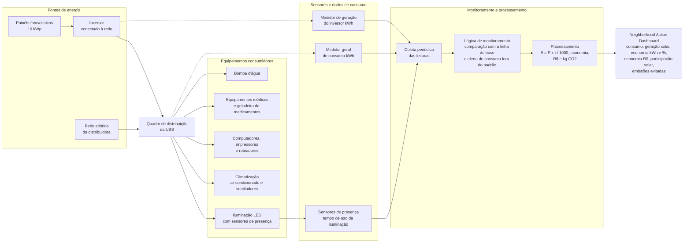

# UBS Sustentável — Eficiência Energética e Energia Solar

**Projeto:** Neighborhood Action Dashboard — CitizenTech  
**Global Solution:** 2026.2  
**Disciplina:** Soluções em Energias Renováveis e Sustentáveis (SERS)

## Integrantes
| Nome completo          | RM     | Turma |
|------------------------|--------|-------|
| Thiago Nascimento de Sá | 575074 | 1CCPS |

## Estrutura do repositório

| Caminho | Conteúdo |
|---|---|
| `SERS/diagnostico.md` | Diagnóstico do problema, público beneficiado e condições de funcionamento |
| `SERS/consumo_energetico.xlsx` | Planilha com inventário, cenários, premissas e estimativa financeira |
| `SERS/calculos.py` | Cálculos de consumo, comparação de alternativas, indicadores e sensibilidade |
| `SERS/comparacao_alternativas.md` | Comparação fundamentada das alternativas A, B e C |
| `SERS/diagrama.mmd` | Diagrama de blocos da solução (Mermaid) |
| `dados/consumo_ubs.csv` | Inventário de equipamentos (dados de entrada) |
| `dados/resultados_cenarios.csv` | Resultados gerados por `calculos.py` |
| `dashboard/dashboard.py` | Dashboard em Streamlit com os indicadores energéticos |

## Como executar

```bash
pip install -r requirements.txt
python SERS/calculos.py             # imprime os cálculos e atualiza dados/resultados_cenarios.csv
streamlit run dashboard/dashboard.py
```

## 1. Objetivo do projeto

Desenvolver uma proposta de modernização energética para uma Unidade Básica de Saúde (UBS), combinando eficiência energética, geração solar fotovoltaica e monitoramento inteligente.

## 2. Problema identificado

As UBS dependem de energia elétrica para iluminação, climatização, computadores, equipamentos médicos e refrigeração.

O consumo desses equipamentos representa despesas operacionais para o município e uma oportunidade de melhoria por meio de tecnologias sustentáveis. Na UBS estudada, o ar-condicionado responde por 54% do consumo e a iluminação convencional por 7,2%; não há monitoramento além da fatura mensal. O detalhamento está em [`SERS/diagnostico.md`](SERS/diagnostico.md).

## 3. Solução proposta

A solução contempla três componentes:

1. Substituição de lâmpadas convencionais por LED e instalação de sensores de presença.
2. Implantação de sistema solar fotovoltaico conectado à rede, com potência estimada de 10 kWp.
3. Monitoramento energético por meio de medidores, processamento de dados e dashboard.

## 4. Diagnóstico e consumo

Foi considerada uma UBS hipotética de São Bernardo do Campo, funcionando de segunda a sexta-feira, das 7h às 17h.

O consumo de cada equipamento foi calculado com `E = (P × t) / 1000`, em que `E` é a energia (kWh), `P` a potência (W) e `t` o tempo de funcionamento (h).

| Equipamento | kWh/mês |
|---|---:|
| Ar-condicionado | 792,00 |
| Computadores | 211,20 |
| Geladeira de medicamentos | 180,00 |
| Lâmpadas convencionais | 105,60 |
| Equipamentos médicos | 88,00 |
| Ventiladores | 42,24 |
| Roteadores | 21,60 |
| Impressoras | 17,60 |
| Bomba d'água | 8,25 |
| **Total** | **1.466,49** |

Consumo original estimado: 1.466,49 kWh/mês (17.597,88 kWh/ano).

Consumo após eficiência energética: 1.394,15 kWh/mês.

## 5. Dimensionamento energético e comparação de alternativas

Foram comparadas três alternativas para a mesma necessidade energética (1.466,49 kWh/mês) e o mesmo período de referência:

| Indicador | A: LED + sensores | B: Solar FV | C: LED + sensores + solar |
|---|---:|---:|---:|
| Consumo da rede (kWh/mês) | 1.394,15 | 266,49 | **194,15** |
| Economia energética (kWh/mês) | 72,34 | 1.200,00 | **1.272,34** |
| Economia energética (%) | 4,93 | 81,83 | **86,76** |
| Investimento (R$) | 1.500 | 26.600 | 28.100 |
| Economia líquida (R$/mês) | 52,10 | 922,26 | **974,36** |
| Retorno simples (meses) | 28,79 | 28,84 | 28,84 |
| Emissões evitadas (kg CO₂/ano) | 40,02 | 663,84 | **703,86** |

Como o retorno é parecido nas três, a escolha se dá pelo tamanho do benefício: a alternativa **C** é a proposta do grupo. A análise completa (viabilidade, custos, impactos ambientais, benefícios, limitações e sensibilidade) está em [`SERS/comparacao_alternativas.md`](SERS/comparacao_alternativas.md).

Resumo da alternativa C:

- Economia com LED e sensores: 72,34 kWh/mês.
- Geração fotovoltaica estimada: 1.200 kWh/mês (10 kWp × 120 kWh/kWp/mês).
- Saldo energético simplificado após as melhorias: 194,15 kWh/mês.
- Redução equivalente do consumo da rede: 86,76%.
- Participação solar no consumo após eficiência: 86,07% (1.200 ÷ 1.394,15). Os dois percentuais são diferentes: um mede a redução da rede em relação ao consumo original; o outro, quanto do consumo restante é coberto pelo sol.

## 6. Investimento e retorno

Investimento em LED e sensores: R$ 1.500.

Investimento no sistema fotovoltaico: R$ 26.600.

Investimento total: R$ 28.100.

Manutenção estimada: R$ 30/mês.

Economia líquida projetada: R$ 974,36/mês.

Payback simples: 28,84 meses.

Os valores são estimativas, não orçamentos. A sensibilidade do retorno à tarifa e à produtividade do sistema está na seção 4 de `SERS/comparacao_alternativas.md` (de 21 a 46 meses nas faixas testadas).

## 7. Impacto ambiental

Fator de emissão adotado: 0,0461 kg CO₂/kWh, valor atribuído ao SIN em 2025. Como o MCTI publica fatores mensais que variam ao longo do ano e entre anos, esse valor deve ser conferido na publicação oficial antes de ser citado como dado final.

Emissões evitadas projetadas: 703,86 kg CO₂/ano (`1.272,34 kWh/mês × 12 × 0,0461`).

## 8. Diagrama de funcionamento

O sistema integra rede elétrica, painéis solares, inversor, quadro de distribuição, equipamentos consumidores, sensores, medidores, processamento e dashboard. O arquivo-fonte é [`SERS/diagrama.mmd`](SERS/diagrama.mmd).



## 9. Indicadores do dashboard

| Indicador | Unidade | Origem |
|---|---|---|
| Consumo energético (da rede) | kWh/mês | `E = (P × t) / 1000` menos economia e geração |
| Geração solar | kWh/mês | `kWp × kWh/kWp/mês` |
| Economia energética | kWh/mês e % | consumo original menos consumo da rede |
| Economia financeira | R$/mês | kWh economizados × tarifa − manutenção |
| Participação solar | % | geração aproveitada ÷ consumo após eficiência |
| Emissões evitadas | kg CO₂/ano | kWh economizados × 12 × fator de emissão |
| Retorno simples | meses | investimento ÷ economia líquida mensal |

O dashboard (`dashboard/dashboard.py`) mostra esses indicadores para cada alternativa, o consumo por equipamento, a comparação entre alternativas e o saldo acumulado em 10 anos, e permite alterar as premissas (potência FV, produtividade, tarifa, fator de emissão e horas de uso da iluminação) para ver o efeito nos resultados.

## 10. Limitações

Os dados são estimativas acadêmicas, não medições reais de uma UBS.

O dimensionamento solar depende de avaliação estrutural, irradiação, orientação, inclinação e sombreamento do telhado.

Os resultados financeiros não representam garantia de retorno. A compensação de energia depende das regras regulatórias, da tarifa aplicável e do perfil de consumo.

Outras simplificações adotadas:

- A tarifa (R$ 0,78938/kWh) é provisória e deve ser validada na fatura real; a classe tarifária de uma UBS pode ser diferente da residencial.
- A produtividade de 120 kWh/kWp/mês é uma hipótese a validar com dados de irradiação local.
- A redução de 10 h para 7 h/dia na iluminação com sensores é uma premissa.
- Não há reajuste de tarifa, degradação dos módulos, troca de inversor nem emissões do ciclo de vida de módulos e lâmpadas.
- Estimativas de economia, geração e emissões são projeções condicionadas às premissas, não resultados garantidos.

## 11. Referências

- Ministério da Ciência, Tecnologia e Inovação (MCTI) — [Fatores de emissão do SIN](https://www.gov.br/mcti/pt-br/acompanhe-o-mcti/sirene/dados-e-ferramentas/fatores-de-emissao).
- Empresa de Pesquisa Energética (EPE) — Custos de sistemas fotovoltaicos.
- Enel São Paulo — Tarifas de energia elétrica.
- ANEEL — reajuste tarifário da Enel São Paulo de 2026 (efeito médio de 10,18%; residencial B1: 9,02%), em vigor desde 4/7/2026, conforme [Cenário Energia](https://cenarioenergia.com.br/2026/06/30/aneel-aprova-reajuste-da-enel-sao-paulo-com-efeito-medio-de-1018/).
- Global Solution 2026.2 — Enunciado SERS.
